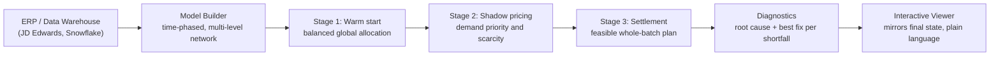

## [▶ Launch the interactive demo](https://jayclouse42.github.io/JDE-Production-Optimizer/)

# Production Planning Network Flow Optimizer

**A constraint-based planning engine that turns a tangle of orders, inventory, and lead times into an executable production plan — and, crucially, explains *why* every shortfall happens and the single best action to fix it.**

> A portfolio showcase of a proprietary planning engine — screenshots, architecture, and a case study below. The engine integrates with ERP / data-warehouse back ends (JD Edwards, Snowflake) for multi-level manufacturing. The source is kept private; a guided walkthrough or code review is available on request.

---

## The problem it solves

Manufacturers run on MRP systems that explode a bill of materials and tell you *what* you're short — but not *why*, and not *what to do about it*. When a plan comes back at 73% fill, a planner is left to reverse-engineer the cause by hand across thousands of work orders, shared ingredients, purchase orders, and expiration dates. So they stop trusting the system and fall back on spreadsheets and gut feel.
The Components in stock are shared over many finished products that are sold, and each product uses different lists of components and qty in its recipe called the Bill of Materials or BOM. When there is scarcity of some components the whole all finished products that use that component are pulling on it with different pressure. The component qty is divisible into units so we don't have to give 100% to the highest pressure, but can share it. The question then becomes how much pressure does each Finished good demand produce. The calculation is non-linear and also not consisted over time as demands fill as POs are received, and sub-assembly productions fill, the supply to demand rations and thus the pressures fluctuate.

This engine was built to close that gap: produce a demand-prioritized, feasibility-aware plan **and** make it legible enough that a planner trusts it instead of overriding it.

## What it does

- **Multi-level (Bill of Materials) BOM explosion with shared-component contention.** Resolves finished goods down through every sub-assembly and raw material, correctly handling ingredients that multiple products compete for.
- **Time-phased feasibility.** Respects on-hand inventory, dated purchase-order and work-order arrivals, lead times, batch sizes, and lot expiration (FEFO) across a rolling 90-day horizon.
- **Demand-prioritized allocation.** When supply can't cover everything, it allocates by a tunable demand priority (firm orders → safety stock → forecast) instead of first-come-first-served.
- **Plain-language diagnostics — the core differentiator.** For every shortfall it identifies the *specific* root cause (no supply, out-competed by a higher-priority order, a purchase order that's too small or too late, product that expires before it can be used) and names the single most effective corrective action.
- **What-if analysis.** Re-solves the full plan under changes — expedite a PO, move a work order, transfer stock between plants — and shows the honest downstream effect, including what a cut really costs in lost vs. gained orders.
- **Interactive supply-chain graph.** A visual map of the production network where feasibility, bottlenecks, and competing demands are visible at a glance.

## How it's different from standard MRP

| Standard MRP / black-box optimizer | This engine |
|---|---|
| Tells you *what* is short | Tells you *why*, and *what to do* |
| Plan is a black box; planners override it | Every number traces to a legible cause |
| First-come allocation | Demand-weighted allocation you can tune |
| Static run | Live what-if re-solves with honest tradeoffs |

## Architecture

The system is a pipeline — data in, an executable *and explained* plan out:

### 1. Data & model layer
Reads demand (firm orders, safety stock, forecast), supply (on-hand inventory by lot and expiry date, dated purchase orders, work-in-process), bills of material, lead times, batch and round-up rules, and plant/sourcing eligibility from the ERP or data warehouse. It assembles these into a **directed, time-phased production network** over a rolling 90-day horizon: nodes are items, work orders, and supply pools; edges are the material flows between them. Multi-level BOMs are fully exploded, so a finished good traces down through every sub-assembly to raw materials — including components that several products draw from one shared, limited pool.

### 2. Solver — three stages
A multi-stage optimizer, deliberately layered so a global view informs a locally feasible result:

- **Warm start (combinatorial).** A global, annealing-style search over the allocation space finds a *balanced* starting point. It matters because a naive greedy start produces lopsided solutions — one product hoards a shared ingredient and starves the others. The warm start keeps every work order in contention before the fine-tuning begins.
- **Shadow pricing (Lagrangian).** An augmented-Lagrangian stage treats each supply/demand balance as a priced constraint and iterates the multipliers to a consistent equilibrium. Those multipliers behave as **marginal prices** — the same mathematical object as the locational marginal prices that clear electricity markets — so every unit of every component is valued by both *how scarce it is* and *how much the demand it serves is worth*. Demand priority (firm orders → safety stock → forecast) enters here as a tunable pressure, not a hard gate.
- **Settlement.** A final pass turns those prices into an executable plan via whole-batch apportionment (largest-remainder, so scarce shared supply is split fairly without fractional batches), first-expiry-first-out consumption, and strict conservation: material is never created or lost across the network (Kirchhoff), and a work order's output is capped by its scarcest input (the minimum-constraint, or Liebig, rule). Production is distributed across each work order's time window rather than treated as instantaneous — and an input that lands mid-window only enables the days *after* it arrives.

### 3. Diagnostic layer
The part that makes planners trust it. For every shortfall, the engine runs a **counterfactual analysis** to isolate the *true* binding constraint — separating "out-competed by a higher-priority order" from "genuinely no supply" from "a purchase order too small or too late" from "stock that expires before it can be used." For each, it names the single highest-impact fix, and the same machinery powers the live what-if re-solves (expedite a PO, move a work order, transfer stock between plants) with honest downstream effects — including what a cut really costs in orders lost versus gained.

### 4. Presentation layer
The viewer mirrors the solver's final state *exactly* — it never recomputes or second-guesses the engine, so there is no "second model" that can quietly disagree with the plan — and renders it as an interactive graph with plain-language explanations. Every number on screen traces back to a cause.

---

*This describes the approach, not the implementation. The specific objective formulations, multiplier-update schemes, and diagnostic internals — the parts that took longest to get right — are deliberately omitted. The engine is proprietary.*

## What's in this repo

This is a **showcase, not the source.** The engine is a working, data-source-agnostic product — point it at a live data warehouse and it runs in full — so the code is kept private to protect it. What you'll find here:

- **Screenshots and a short walkthrough** of the interactive viewer and its diagnostics.
- **Sample outputs** (plans, shortfall explanations, what-if comparisons) generated from a synthetic, anonymized dataset — no real company data.
- **A case study** describing the approach and a proposed A/B methodology for validating it against a live baseline.

*A guided walkthrough or a private code review is available on request.*

## Tech stack

Python (pandas, NumPy, SciPy, NetworkX), a Flask service layer, and an HTML/JavaScript interactive viewer. Designed to integrate with JD Edwards / data-warehouse back ends in production.

## Status — an honest note

This is a personal project and a working proof of concept, validated on synthetic data that mirrors real manufacturing structure. It has **not** been run as the system of record in live production — doing so would mean a controlled trial against the existing planning process, which the case study lays out. The claims here are about **design and capability**, not measured deployment savings.

## About

Built by **Jay Clouse** — supply chain analyst with ~10 years in manufacturing and distribution operations, ERP (JD Edwards, SAP), and applied optimization. The aim of this project: bring rigorous, proven planning methods into a field that still largely runs on spreadsheets — carefully, and legibly enough to earn a planner's trust.

📫 clousejay@gmail.com
